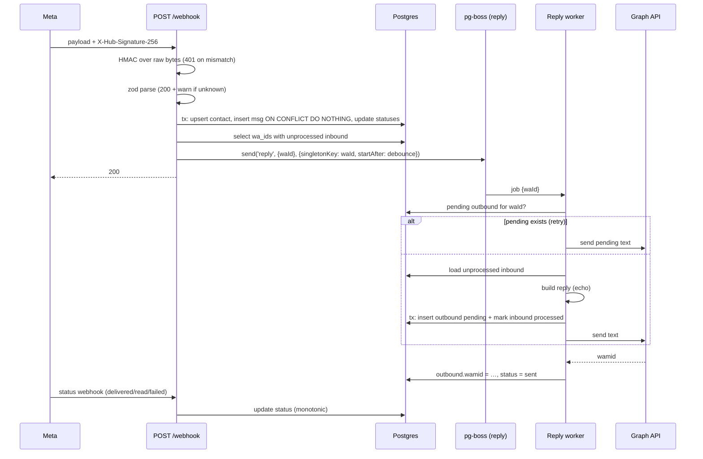

# 002 — Echo bot: Design

## Sequence



## Module layout

```
src/
├── http/
│   ├── app.ts                    # mounts /healthz, /webhook
│   └── webhook/
│       ├── route.ts              # GET verify, POST handler
│       ├── signature.ts          # verifySignature(rawBody, header, secret): boolean
│       ├── payload.ts            # zod schema + extractEvents(payload) → {messages, statuses, contacts}
│       └── ingest.ts             # persistInbound(db, events, allowlist) → waIdsToEnqueue
├── whatsapp/
│   └── client.ts                 # createWhatsAppClient({fetch, token, phoneNumberId, version})
│                                 #   .sendText(to, body) → wamid
│                                 #   .markRead(wamid)
│                                 # throws RetryableError | PermanentError
├── queue/
│   ├── boss.ts
│   └── queues.ts                 # queue names + options (single source)
├── worker/
│   ├── reply.ts                  # handleReplyJob(deps, {waId})
│   └── compose-echo.ts           # pure: (inbound[]) → string | null
└── db/
    ├── schema.ts
    └── messages.ts               # small query functions used by ingest + worker
```

`compose-echo.ts` is the only part replaced in 003 (by an LLM composer). Everything around it stays.

## Data model

```ts
// src/db/schema.ts (sketch, check the Drizzle API for the current version)
export const contacts = pgTable("contacts", {
  waId: text("wa_id").primaryKey(),
  name: text("name"),
  botPaused: boolean("bot_paused").notNull().default(false),
  lastInboundAt: timestamp("last_inbound_at", { withTimezone: true }),
  createdAt: timestamp("created_at", { withTimezone: true }).notNull().defaultNow(),
  updatedAt: timestamp("updated_at", { withTimezone: true }).notNull().defaultNow(),
});

export const messageDirection = pgEnum("message_direction", ["in", "out"]);
export const messageStatus = pgEnum("message_status",
  ["received", "pending", "sent", "delivered", "read", "failed"]);

export const messages = pgTable("messages", {
  id: bigserial("id", { mode: "bigint" }).primaryKey(),
  wamid: text("wamid").unique(),                // null for pending outbound
  waId: text("wa_id").notNull().references(() => contacts.waId),
  direction: messageDirection("direction").notNull(),
  type: text("type").notNull(),                 // text | image | audio | reaction | …
  body: text("body"),
  status: messageStatus("status").notNull(),
  error: jsonb("error"),                        // {code, title, details}
  metaTimestamp: timestamp("meta_timestamp", { withTimezone: true }),
  processedAt: timestamp("processed_at", { withTimezone: true }), // inbound only
  createdAt: timestamp("created_at", { withTimezone: true }).notNull().defaultNow(),
}, (t) => [
  index("messages_wa_id_created_idx").on(t.waId, t.createdAt),
  index("messages_unprocessed_idx").on(t.waId).where(sql`direction = 'in' AND processed_at IS NULL`),
  index("messages_pending_out_idx").on(t.waId).where(sql`direction = 'out' AND status = 'pending'`),
]);
```

Postgres allows many NULLs in a unique column, so pending outbound rows don't collide.

## Signature verification

```ts
// Read raw bytes BEFORE any JSON parsing; Hono's c.req.json() would consume the body.
const raw = Buffer.from(await c.req.arrayBuffer());
const header = c.req.header("x-hub-signature-256") ?? "";
if (!verifySignature(raw, header, config.appSecret)) return c.body(null, 401);
const payload = JSON.parse(raw.toString("utf8")); // then zod
```

`verifySignature`: check the `sha256=` prefix and that the hex is 64 characters. Compute `createHmac("sha256", secret).update(raw).digest()` and compare the decoded header bytes with `timingSafeEqual`, checking lengths first (`timingSafeEqual` throws when lengths differ).

Malformed JSON with a valid signature can't come from Meta. Return 400.

## Ingest transaction

```
BEGIN
  for each contact in payload: INSERT … ON CONFLICT (wa_id) DO UPDATE SET name = EXCLUDED.name, updated_at = now()
  for each message (allowlisted only):
    INSERT INTO messages (…) VALUES (…) ON CONFLICT (wamid) DO NOTHING
    UPDATE contacts SET last_inbound_at = GREATEST(coalesce(last_inbound_at, '-infinity'), $ts) WHERE wa_id = $waId
  for each status:
    UPDATE messages SET status = $new, error = $err
     WHERE wamid = $wamid AND direction = 'out' AND rank(status) < rank($new)
COMMIT
SELECT DISTINCT wa_id FROM messages WHERE wa_id = ANY($payloadWaIds) AND direction='in' AND processed_at IS NULL
→ boss.send('reply', {waId}, {singletonKey: waId, startAfter: DEBOUNCE_SECONDS})
```

The status rank is a SQL `CASE` (pending 0, sent 1, delivered 2, read 3, failed 4 when the current status is below `delivered`). This keeps the update atomic, with no read-modify-write race.

**Why enqueue sits outside the transaction:** pg-boss can take a custom `db` executor to enqueue inside the same transaction. That's possible but couples the two libraries. Enqueuing whenever unprocessed messages exist (ECH-FR-05) recovers from a failed enqueue on the next Meta retry, which is simpler and good enough. Revisit if Meta stops retrying for long enough to matter (it retries for days, with backoff).

## Queue configuration

```ts
// src/queue/queues.ts
export const REPLY_QUEUE = "reply";
await boss.createQueue(REPLY_QUEUE, {
  policy: "stately",      // ≤1 queued + ≤1 active per singletonKey
  retryLimit: 5,
  retryDelay: 2,
  retryBackoff: true,
  expireInSeconds: 120,
});
boss.work(REPLY_QUEUE, { batchSize: 1, localConcurrency: 4 }, handler);
```

- `stately` gives ECH-FR-08: a send while one job is queued for the key is a no-op (that's fine, because the queued job reads **all** unprocessed messages when it runs), and a send while one is active creates exactly one follow-up.
- **Verify against the pinned pg-boss version:** policy names, `localConcurrency` vs `teamSize`, and whether handlers receive `Job[]`. These changed in v10.
- `DEBOUNCE_SECONDS` is 0 in this spec and becomes configurable in 003.

## Reply worker

```
handleReplyJob({ waId }):
  pending = select outbound where wa_id = waId and status = 'pending' order by id limit 1
  if pending: return send(pending)

  inbound = select inbound where wa_id = waId and processed_at is null order by meta_timestamp
  if inbound is empty: return                       // already handled by an earlier job
  text = composeEcho(inbound)                       // null → nothing to send
  tx:
    update messages set processed_at = now() where id in inbound.ids and processed_at is null
      → if rowcount != inbound.length: abort and return  // another worker won; defensive
    if text: insert outbound (pending, body = text)
  if text: send(outbound)
  best-effort markRead(last inbound wamid)

send(outbound):
  try wamid = whatsapp.sendText(waId, body)
      update outbound set wamid, status = 'sent'
  catch PermanentError e: update outbound set status = 'failed', error = e.info   // job succeeds
  catch RetryableError: rethrow                                                   // pg-boss retries
```

**Accepted risk:** if the process dies after Meta accepts the message but before the row is updated, the retry sends a duplicate. The window is one DB write long. Closing it fully would need an idempotency key, which the Cloud API doesn't offer for sends.

## WhatsApp client

- `POST https://graph.facebook.com/{version}/{phoneNumberId}/messages` with body `{ messaging_product: "whatsapp", to, type: "text", text: { body, preview_url: false } }`.
- `markRead`: same endpoint with `{ messaging_product: "whatsapp", status: "read", message_id }`.
- `fetch` is injected. `AbortSignal.timeout(10_000)`.
- Error parsing: the Graph error body is `{ error: { code, message, error_subcode, error_data } }`. Classify by HTTP status (429/5xx → retryable), plus code `130429` (throughput limit) as retryable even when it comes back as a 400. **Verify the error code list on Meta's docs.**
- Tests use a fake `fetch`. No network in tests.

## Testing strategy

| Layer | Type | Notes |
|---|---|---|
| `signature.ts`, `compose-echo.ts`, `payload.ts` | Unit | Pure functions, fixtures in `test/fixtures/webhooks/*.json` copied from Meta's docs |
| `ingest.ts`, status updates | Integration | Real Postgres |
| `/webhook` route | Integration | `app.request()` with signed fixtures (`signFixture(body, secret)` helper) |
| Reply worker | Integration | Real Postgres + real pg-boss + fake fetch |
| ECH-NFR-02 | Integration | 100 concurrent `app.request()` calls with the same payload, then drain the queue |
| End to end | Manual | Test number → allowlisted phone over the ngrok tunnel |

## Constitution check

| Article | How this design complies |
|---|---|
| I | Cloud API only |
| III | `waId` comes from the verified webhook into the job payload. Nothing user-supplied picks the recipient. |
| IV | Unique `wamid`, monotonic status, pending-outbound replay, `stately` queue |
| VI | HMAC over raw bytes, constant time, before parsing |
| IX | `ALLOWED_WA_IDS` enforced at ingest |
| X | Status tracking and error-code classification included now |
