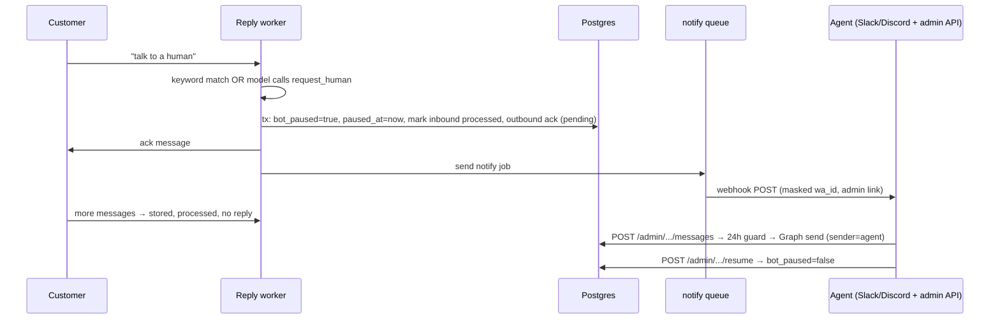

# 005 — Handoff + media: Design

## Data model changes

```ts
// contacts
pausedAt: timestamp("paused_at", { withTimezone: true }),
lastAgentMessageAt: timestamp("last_agent_message_at", { withTimezone: true }),

// messages
sender: text("sender").notNull().default("bot"),   // bot | agent | customer (inbound uses customer)
media: jsonb("media"),        // { mediaId, mime, bytes, sha256, path, state: pending|ready|rejected|failed, deletedAt }
transcribed: boolean("transcribed").notNull().default(false),
```

Index: `messages(wa_id) WHERE direction='in' AND media->>'state' = 'pending'`, for the HND-FR-08 check.

## Queues

| Queue | Key | Policy | Purpose |
|---|---|---|---|
| `reply` | `wa_id` | stately (from 002) | Unchanged, plus a pause check and a media-pending deferral |
| `media` | `wamid` | standard, retryLimit 3, backoff | Download + (audio) transcribe |
| `notify` | handoff id | standard, retryLimit 5 | Agent notification webhook |
| `maintenance` | — | `boss.schedule` cron | Auto-resume (every 15 min), media cleanup (daily) |

The webhook enqueues `media` jobs for media messages **in the same request** as the `reply` enqueue. The `reply` job starts `DEBOUNCE_SECONDS` later. If media is still pending at that point, it re-enqueues itself with `startAfter: 2` (at most 15 deferrals, then it proceeds and treats the media as failed).

## Handoff flow



The keyword check runs **before** the LLM call. That's cheaper, and it works even when the LLM is down or rate-limited, which is exactly when customers ask for a human.

`request_human` is a tool with an empty input schema. Its executor only sets a flag on the turn result. The worker applies the pause in the same transaction as the acknowledgement, so the tool itself has no side effects that can't be rolled back.

## Admin API

- Hono sub-app at `/admin` with a bearer middleware (constant-time compare against `ADMIN_TOKEN`).
- The responses are the only place full `wa_id`s and bodies leave the server. Serve them over HTTPS only (through the tunnel when testing) and never log response bodies.
- Agent sends reuse the shared `send()` (24-hour guard, status tracking) with `sender='agent'`, and update `last_agent_message_at`.
- Auto-resume query: `UPDATE contacts SET bot_paused=false WHERE bot_paused AND greatest(paused_at, coalesce(last_agent_message_at, paused_at)) < now() - interval '<N> hours'`.

## Media pipeline

```
media job {wamid, mediaId, waId}:
  meta = GET /{version}/{mediaId}           → { url, mime_type, file_size, sha256 }
  reject if mime not in allowlist or file_size > MEDIA_MAX_BYTES  → state=rejected
  stream GET meta.url (Authorization: Bearer token), abort if bytes > cap
  write to MEDIA_DIR/<yyyy>/<mm>/<uuid>.<ext-from-mime>
  verify sha256 matches meta.sha256
  state=ready
  if audio: transcript = stt(file) → messages.body, transcribed=true (STT failure → body=null, state stays ready, flag stt_failed)
  404/410 on url → permanent fail (state=failed)
  5xx/network → retry (URL may expire; re-fetch meta each attempt)
```

MIME allowlist: `audio/ogg`, `audio/mpeg`, `audio/mp4`, `audio/aac`, `image/jpeg`, `image/png`, `image/webp`, `application/pdf`. Check the type from the file's magic bytes too, not only the declared MIME.

**Storage:** local disk for the test profile. In 006, an S3-compatible bucket (Cloudflare R2 has a free tier with no egress fees). Keep a tiny `storage.put/get/delete` interface **only when** the second backend actually arrives (constitution XI). Use plain `fs` until then.

## Model message assembly additions

| Inbound | Content sent to the model |
|---|---|
| audio with transcript | `user` text: `[voice note] <transcript>` |
| audio, STT failed | the fallback is sent directly, no LLM call |
| image + vision model | `user` parts: `[{type: image, data}, {type: text, caption ?? ""}]` |
| image, no vision | the fallback is sent directly |
| location | `user` text: `[location] lat,lng (name, address)` |

Vision capability is a config flag (`LLM_SUPPORTS_IMAGES`) rather than auto-detected. Explicit is easier to test.

## Constitution check

| Article | How this design complies |
|---|---|
| III | Admin endpoints are operator-only, behind the token. Customer tools still use `ctx.waId`. |
| IV | Media job keyed by `wamid`. Pause and acknowledgement in one transaction. Notify retried idempotently (repeated Slack posts are acceptable, see below). |
| V | `ADMIN_TOKEN` and the access token are server-side. Media URLs are fetched with the token and never exposed. |
| VI | Magic-byte check, size cap, sha256 verify |
| IX | STT through the free tier only for allowlisted senders (ingest already filters) |
| X | Media URL expiry → immediate download job |

Accepted risk: a notify retry after a timeout where Slack actually received the post produces a duplicate Slack message. That's harmless, so no dedupe.
